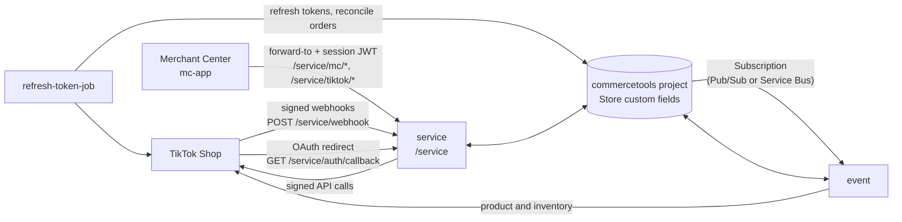

# TikTok Shop integration for commercetools

Sell your commercetools catalog on TikTok Shop without building the plumbing yourself. This connector publishes
products and stock from a commercetools project to one TikTok shop, and brings TikTok orders back into commercetools.

**Who it is for:** teams that run a commercetools project and want to list products on TikTok Shop, or developers who
want a working reference for a TikTok Shop connector (OAuth, signed API calls, webhooks, token storage) on
commercetools Connect.

**What you get:**

- Product and inventory sync from commercetools to TikTok Shop, automatically on change and on demand (full or selective).
- TikTok orders, cancellations and returns imported into commercetools, driven by signed TikTok webhooks.
- A Merchant Center custom application to authorize the shop, map product types and attributes to TikTok categories, and run syncs.
- Four Connect applications and the Terraform for the custom types they need.

This project is freely available, provided as is, and not supported by commercetools. See [SUPPORT.md](SUPPORT.md).

> One deployment connects **one commercetools project to one TikTok shop**. You register your own TikTok Shop partner
> app and the connector uses its key and secret. There is no shared multi-tenant backend.

## Architecture



| Application | Type | Responsibility |
|-------------|------|----------------|
| `mc-app` | Merchant Center custom application | Setup wizard, **Authorize with TikTok** button and status, product mappings, sync actions. Talks only to `service`, through the Merchant Center `forward-to` proxy. |
| `service` | service, endpoint `/service` | TikTok webhook receiver (HMAC verified), OAuth callback, the Merchant Center API, TikTok category metadata. Imports orders inline. |
| `event` | event | Consumes commercetools product and inventory messages and creates, updates or deactivates TikTok products and stock. |
| `refresh-token-job` | job, every 12 hours | Refreshes TikTok tokens before they expire and reconciles orders that webhooks may have missed. |

Shared code (config, commercetools client, encryption, state, TikTok client and signing, mapping engine) lives in
[`shared/`](shared). It is a plain folder imported by relative path from `service`, `event` and `refresh-token-job`;
`mc-app` is self-contained and never imports it.

All state lives on the commercetools **Store** marked `isTikTokShop`, as custom fields of `tiktok-store-type`
(shop identity, encrypted tokens, mappings). There is no database and no Custom Object. See
[terraform/README.md](terraform/README.md).

## Prerequisites

- A commercetools Composable Commerce project and permission to deploy Connect connectors and Merchant Center custom applications.
- A TikTok Shop seller account and a TikTok Shop **partner app** you own, from [TikTok Shop Partner Center](https://partner.tiktokshop.com/). You need its app key and app secret.
- [Terraform](https://developer.hashicorp.com/terraform/downloads) and a short-lived API client with `manage_types`, `manage_products`, `manage_stores`.
- Node.js 22 and Yarn 1 for local work.
- A TikTok warehouse set up in Seller Center (the connector pushes stock to it).

## The two URLs to set in TikTok Partner Center

The connector only works if your TikTok partner app has these two URLs registered. Everything else in setup can be fixed
later; these two cannot be guessed by TikTok.

| Partner Center field | Route | Full URL (example) | Used for |
|---|---|---|---|
| **Redirect URL** | `GET /service/auth/callback` | `https://<connect-service-host>/service/auth/callback` | TikTok sends the seller's browser here after they click **Authorize with TikTok**. Without it the shop never connects. |
| **Webhook (callback) URL** | `POST /service/webhook` | `https://<connect-service-host>/service/webhook` | TikTok delivers order, cancellation, return and deauthorization events here. Without it no orders arrive. |

- Both URLs are `<service-url>` plus the route, where `<service-url>` is the URL Connect shows for the `service`
  application and **already ends in `/service`**. Do not add a second `/service`, and do not drop it: a registration
  like `https://…/webhook` or `https://…/auth/callback` (no `/service`) reaches nothing and fails silently.
- Copy them exactly. TikTok sends the redirect only to the registered value.
- They must be public HTTPS URLs. For local work use a tunnel, see [docs/local-development.md](docs/local-development.md).
- The Merchant Center app URL is a different thing; it does not go in these fields.

If either is wrong, see the symptoms in [docs/setup.md](docs/setup.md#troubleshooting) and [docs/webhooks.md](docs/webhooks.md).

## Setup in two phases

TikTok must be given your service URL, and Connect only knows that URL after the first deploy. The Merchant Center app
in turn needs the service URL as configuration. So setup runs in two phases. The short version below; the full
walkthrough is in [docs/setup.md](docs/setup.md).

**Phase 1: deploy and register**

1. Generate an encryption key: `openssl rand -base64 32`.
2. Register the Merchant Center custom application (placeholder URL) to get its `CUSTOM_APPLICATION_ID`.
3. Deploy the connector with the configuration below. Leave `SERVICE_URL` empty.
4. Copy the **service URL** Connect shows for the `service` application. It ends in `/service`.
5. In TikTok Partner Center, open your app and register the [two URLs above](#the-two-urls-to-set-in-tiktok-partner-center):
   - webhook (callback) URL: `<service-url>/webhook`
   - redirect URL: `<service-url>/auth/callback`
6. Run Terraform in [`terraform/`](terraform) to create the types, channel and store.

**Phase 2: connect**

7. Set `SERVICE_URL` on `mc-app` to the service URL and **redeploy `mc-app`**. Connect does not pass the service URL to the
   Merchant Center app, so this redeploy is required. Until then the app shows a "service not configured" screen.
8. Open the app in the Merchant Center and run the wizard: choose an existing store or create a new one (with its product selection and channels), click **Authorize with TikTok**, then choose the TikTok warehouse from the list TikTok returns.
9. The callback exchanges the code for tokens, derives the shop id, cipher, region and warehouses, stores them encrypted on the Store, and registers the webhook topics.

## Configuration

Set these when you create the deployment (`commercetools connect deployment create`) or in the Connect UI. They are
declared in [`connect.yaml`](connect.yaml).

### mc-app

| Key | Required | Description |
|-----|----------|-------------|
| `CUSTOM_APPLICATION_ID` | yes | Application ID the Merchant Center shows after you register the custom application. |
| `ENTRY_POINT_URI_PATH` | yes (default `tiktok-connect`) | Entry point URI path the application is registered with. |
| `SERVICE_URL` | no, but required for the app to work | Public URL of `service`, ending in `/service`. Set manually after the first deploy, then redeploy `mc-app`. |

`APPLICATION_URL` is provided by Connect.

### Shared by all applications

| Key | Required | Description |
|-----|----------|-------------|
| `CTP_REGION` | yes (default `europe-west1.gcp`) | commercetools API region. |
| `CLOUD_IDENTIFIER` | yes (default `gcp-eu`) | Merchant Center cloud of your project, for example `gcp-eu`, `gcp-us`. Also selects the issuer `service` trusts for Merchant Center sessions. |
| `TIKTOK_APP_KEY` | yes | App key of your TikTok partner app. |
| `TIKTOK_APP_AUTHORIZATION_LINK` | no | Authorization link of your partner app. If empty, the app builds it from the app key. |
| `TIKTOK_APP_SECRET` | yes, secured | App secret of your partner app. Verifies webhook signatures and signs API calls. |
| `ENCRYPTION_KEY` | yes, secured | 32 random bytes, base64 (`openssl rand -base64 32`). Encrypts stored tokens and signs the OAuth `state`. |

The commercetools API client (`CTP_PROJECT_KEY`, `CTP_CLIENT_ID`, `CTP_CLIENT_SECRET`, `CTP_SCOPE`, and the API and auth
URLs) is generated by Connect from `inheritAs.apiClient` in `connect.yaml`. `CONNECT_SERVICE_URL` and the event topic
variables (`CONNECT_*`) are also provided by Connect.

### API client scopes

| Scope | Why |
|-------|-----|
| `view_products` | Read products, product types, channels, inventory entries and product tailoring. |
| `view_categories` | Expand category references while mapping. |
| `manage_stores` | Write the TikTok fields on the Store. |
| `view_types` | Resolve `tiktok-order-info` and `tiktok-store-type`. |
| `view_states` | Order states used for imported orders. |
| `manage_orders` | Import TikTok orders, apply status, cancellation and return updates. |
| `manage_payments` | Record the payment of imported orders. |
| `manage_subscriptions` | `event` creates the product and inventory Subscription on deploy and removes it on undeploy. |

Types, channels and product types are created by Terraform with your own setup client, not by the connector.

## Routes

All routes are mounted under `/service`.

| Route | Caller | Auth | Purpose |
|-------|--------|------|---------|
| `POST /service/webhook` | TikTok | HMAC-SHA256 of app key + raw body, header `Authorization` | Webhook receiver. Replies 200 fast, dispatches on the topic payload. |
| `GET /service/auth/callback` | TikTok redirect (browser) | signed, short-lived `state` | Exchanges `code` for tokens and stores them. Shows a success or error page. |
| `GET /service/mc/authorization-link` | Merchant Center | session | Returns the TikTok authorization link with a signed `state`. |
| `GET /service/mc/connection-status` | Merchant Center | session | Authorized or not, shop name, token expiry. Never returns tokens. |
| `POST /service/mc/full-product-sync` | Merchant Center | session | Syncs all products of the TikTok store. |
| `POST /service/mc/selective-product-sync` | Merchant Center | session | Body `{"productIds": [...]}`. |
| `GET /service/mc/full-product-check` | Merchant Center | session | Reports which products can be imported to TikTok. |
| `POST /service/mc/shop-config-sync` | Merchant Center | session | Refreshes shop cipher, region, locale and warehouses. |
| `GET`, `PUT /service/mc/mappings` | Merchant Center | session | Reads and writes `mappingConfig`. |
| `GET /service/tiktok/categories` | Merchant Center | session | TikTok category tree. |
| `GET /service/tiktok/categories/:id/rules` | Merchant Center | session | Category rules. |
| `GET /service/tiktok/categories/:id/attributes` | Merchant Center | session | Category attributes. |
| `GET /service/tiktok/attributes?category_id=` | Merchant Center | session | Attributes for a category. |
| `GET /service/health` | Connect, operators | none | Liveness. |

"Session" means the Merchant Center session JWT forwarded by the `forward-to` proxy: signature, issuer, audience and
expiry are verified, and the project key must match this deployment's project (otherwise 403). The connector
assumes it is deployed into your organization and does **not** check Merchant Center permissions or roles: anyone who can
open the custom application can use it. Restrict access to the application in the Merchant Center if that is not what you want.

## Token storage security

TikTok access and refresh tokens are encrypted with AES-256-GCM (`ENCRYPTION_KEY`) before they are written to the Store's
custom fields, and are never logged or returned by an API. Encryption means a reader of the Store sees ciphertext, not
usable tokens. It does not protect against someone who also holds `ENCRYPTION_KEY`, and rotating the key means
authorizing the shop again. The app secret never goes on the Store. Details and a review checklist:
[docs/token-storage-security.md](docs/token-storage-security.md).

## Failure behavior

| Situation | Behavior |
|-----------|----------|
| Webhook signature missing or wrong | **Fail closed**: 401, nothing processed. |
| Merchant Center session invalid, expired, wrong audience or issuer | **Fail closed**: 401. Another project: 403. |
| Stored state unreadable or decryption fails | **Fail closed**: no TikTok call is made; the error is logged without secrets. |
| Webhook for an unknown `shop_id` | **Fail open**: 200 and a log line, so TikTok does not retry forever. |
| Webhook processing error after a valid signature | Logged with the notification id. Handlers re-fetch the order from TikTok and are idempotent, so a TikTok retry or the reconcile job repairs it. |
| Product or inventory message cannot be processed | `event` answers non-2xx and the message is redelivered. See the runbook below. |
| TikTok access token near expiry | Refreshed lazily on use; `refresh-token-job` is the safety net. |
| Seller deauthorization webhook | Stored tokens are cleared, `tiktokDeauthorizedAt` is set, calls to TikTok stop. Authorize again to resume. |

Errors returned to callers are generic; stack traces stay in the logs.

## Operations

### Poison messages and replay

A product or inventory message that can never succeed (for example a product that fails TikTok validation) is
redelivered until Connect's retention or dead-letter policy removes it.

1. Find it in the `event` logs: search by the product id or the correlation id in the error line.
2. Run `GET /service/mc/full-product-check` (or the **Check** action in the app) to see why TikTok rejects the product.
3. Fix the data or the mapping in commercetools or the app.
4. Replay without touching the queue: use **selective product sync** with the product ids, or **full product sync**. Syncs are idempotent.
5. If the message is still being redelivered after the cause is fixed, drain or dead-letter it in the Pub/Sub or Service Bus console.

### Webhook replay and the reconcile job

TikTok's signature has no timestamp, so there is no replay protection at the transport level. Handlers are idempotent
(they re-fetch the order and set the state) and the `tts_notification_id` is logged for tracing. TikTok also advises not
to rely on webhooks alone, so `refresh-token-job` runs a reconcile pass every 12 hours that re-reads recent orders from TikTok and
fixes any commercetools order that is missing or out of date. To force a repair, run the job from the Connect console.

More on topics, signature and registration: [docs/webhooks.md](docs/webhooks.md).

## Development

```console
cd <service|event|refresh-token-job|mc-app>
yarn install
yarn tsc --noEmit
yarn test
yarn build
```

Copy `.env.example` to `.env` in each backend app for local runs. Never commit `.env`. To run the service and the
Merchant Center app together (this needs a public tunnel URL), see [docs/local-development.md](docs/local-development.md).
Terraform:

```console
cd terraform && terraform init -backend=false && terraform validate
```

## Contributing and license

See [CONTRIBUTING.md](CONTRIBUTING.md). Released under the [MIT License](LICENSE). The vendored TikTok Shop SDK in
`shared/tiktok-sdk` is generated code published by TikTok.
