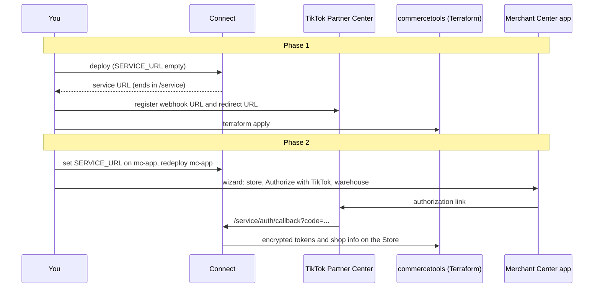

# Setup

One deployment connects one commercetools project to one TikTok shop. Setup has two phases (the SDK, step 1, is part of phase 1) because the TikTok partner app
needs your service URL, which only exists after the first deploy, and the Merchant Center app needs that same URL as
configuration.



## 0. Before you start

- A TikTok Shop partner app from [Partner Center](https://partner.tiktokshop.com/): note the **app key** and **app secret**. Choose the seller authorization type and the scopes for products, orders, inventory and shop information.
- The TikTok Shop **Node.js SDK** from Partner Center, see [step 1](#1-add-the-tiktok-nodejs-sdk). It is not part of this repository.
- A commercetools project and its Merchant Center cloud (`gcp-eu`, `gcp-us`, ...).
- `openssl rand -base64 32` for `ENCRYPTION_KEY`. Store it somewhere safe; losing it means re-authorizing.

## 1. Add the TikTok Node.js SDK

The connector calls TikTok through TikTok's own Node.js SDK. It is published by TikTok under its own terms, so this repository does not include it: download it from Partner Center and add it to your copy. Do this first, because `service`, `event` and `refresh-token-job` do not compile without it.

1. In [Partner Center](https://partner.tiktokshop.com/), go to **Development kits**, then **SDKs**, and download **Node.js**.
2. Unzip it into `shared/tiktok-sdk/` so that the contents of the archive sit directly in that folder, not in a subfolder:

   ```text
   shared/
   └── tiktok-sdk/
       ├── README.md
       ├── api.ts
       ├── index.ts
       ├── api/
       ├── client/
       ├── model/
       └── utils/
   ```

   Do not edit the files by hand; to upgrade, replace the folder with a newer download.
3. **Commit it together with your code.** Connect builds from your repository at the release tag you deploy, so an SDK that is only on your machine is missing from the deployment and the build fails. Add the folder before you tag the release.

## 2. Register the Merchant Center custom application

In the Merchant Center, Organization settings, Custom applications, register an application with the entry point
`tiktok-connect` and a placeholder URL. Note its **Application ID**. Connect hosts the application and
you update the URL later.

The application needs these OAuth scopes (they are in [`custom-application-config.mjs`](../mc-app/custom-application-config.mjs)):
`view_products`, `manage_products`, `view_stores`, `manage_stores`, `view_product_selections`, `manage_product_selections`.
The product selection scopes are only used by the wizard's **create a new store** form. If you registered the
application before they existed, add them to the application's permissions, or the form shows an error when it
reads or creates product selections.

## 3. Deploy the connector

Create the connector from this repository and a release tag, then a deployment with:

| Key | Value |
|-----|-------|
| `mc-app.CUSTOM_APPLICATION_ID` | the Application ID from step 2 |
| `mc-app.ENTRY_POINT_URI_PATH` | `tiktok-connect` |
| `mc-app.SERVICE_URL` | leave empty for now |
| `CTP_REGION` | your API region |
| `CLOUD_IDENTIFIER` | your Merchant Center cloud |
| `TIKTOK_APP_KEY` | partner app key |
| `TIKTOK_APP_SECRET` | partner app secret |
| `ENCRYPTION_KEY` | the key from step 0 |
| `TIKTOK_APP_AUTHORIZATION_LINK` | optional |

Connect generates the commercetools API client from the scopes in `connect.yaml` (listed with reasons in the
[README](../README.md#api-client-scopes)). The first deploy runs the `postDeploy` scripts, which create the
product and inventory Subscription for `event`.

## 4. Register the URLs in TikTok Partner Center

These two are the most important settings in the whole setup. Take the **service URL** of the `service` application from
the deployment (it ends in `/service`) and enter, in your partner app:

- Webhook (callback) URL: `<service-url>/webhook`, for example `https://<connect-service-host>/service/webhook`
- Redirect URL: `<service-url>/auth/callback`, for example `https://<connect-service-host>/service/auth/callback`

Do this exactly; TikTok sends the redirect to the registered URL only. Leaving out `/service` is the most common mistake
and fails silently. See [the README](../README.md#the-two-urls-to-set-in-tiktok-partner-center). Also update the app's Merchant Center custom
application URL if Connect gives you a new one.

## 5. Apply Terraform

```console
cd terraform
# create secrets.tfvars as described in terraform/README.md
terraform init
terraform apply -var-file secrets.tfvars
```

This creates the channel type and channel, the store type (with the connector's state fields), the store, the order type. Use a dedicated store for TikTok, not your main store. Delete the setup API client after.

## 6. Set `SERVICE_URL` and redeploy `mc-app`

Update the deployment's `mc-app.SERVICE_URL` to the service URL from step 4 (ending in `/service`) and **redeploy `mc-app`**.
Connect does not pass the service URL to the Merchant Center app, so there is no way around this step. Without
it the app shows a "service not configured" screen.

## 7. Authorize

The wizard has three steps. TikTok is authorized second because the tokens are saved on the store you choose first.

1. **Store.** Open **TikTok Connect** in the Merchant Center and either:
   - **use an existing store** (for example `tiktok-store` from Terraform). It gets `isTikTokShop = true` and keeps its own channels, so it needs a distribution channel and an inventory supply channel; or
   - **create a new store.** The form asks for the store name and key, then an optional **product selection** (use an existing one, create one, or untick the box to create the store without one) and the **channels**. By default one channel serves as both the price (distribution) and the inventory (supply) channel; untick the box to choose or create a separate channel for each. Existing channels are offered only if they carry the needed role: `ProductDistribution` for price, `InventorySupply` for inventory. New channels get those roles. The store is created already marked `isTikTokShop = true`.

   No warehouse is asked here, because TikTok is not authorized yet. If a step fails part way, fix the cause and submit again: what was already created is reused.
2. **Authorize.** Click **Authorize with TikTok** and approve in TikTok. You are redirected to `<service-url>/auth/callback`. The callback exchanges the code for tokens, reads the shop id, cipher, region and warehouses, encrypts the tokens and writes everything to the Store, then registers the webhook topics.
3. **Warehouse.** Choose the TikTok warehouse from the list TikTok returned. The wizard saves it as `warehouseId` on the store's channels and marks them as the TikTok price and warehouse channels. If TikTok returned no warehouses, copy the warehouse ID from TikTok Seller Center, Settings, Warehouses, and paste it.

The app status screen then shows the shop name and token expiry. If the saved `warehouseId` is not one of the shop's TikTok warehouses (a typo or a placeholder), the wizard opens at step 3 again so you can replace it.

## 8. First sync

Open the mappings screen, map each product type to a TikTok category and its attributes, run **Full product check** to see
what TikTok would accept, then **Full product sync**. From then on `event` keeps products and stock in step.

## Reconnecting and rotating

- Authorization expired or the seller deauthorized: click **Authorize with TikTok** again.
- Changed `ENCRYPTION_KEY`: redeploy, then authorize again. See [token-storage-security.md](token-storage-security.md).
- Moved to a new service URL (new deployment): update both URLs in Partner Center, set `SERVICE_URL`, redeploy `mc-app`.

## Troubleshooting

| Symptom | Check |
|---------|-------|
| App says "service not configured" | `SERVICE_URL` set and `mc-app` redeployed; it must end in `/service`. |
| Redirect shows an error page | Redirect URL in Partner Center must match `<service-url>/auth/callback`; the authorization link is short-lived, request a fresh one. |
| "A value is required for field 'warehouseId'" | Only seen on older versions of the wizard. Update `mc-app`; the warehouse is now chosen in step 3, after TikTok is authorized. |
| "The product selections could not be read" in the **create a new store** form | The custom application lacks `view_product_selections` / `manage_product_selections`. Add them to its permissions, see step 2. |
| "No TikTok store" on authorization | The wizard has not marked a store `isTikTokShop`, or Terraform has not been applied. |
| "The setup state could not be read" with 401 (Unauthorized); the wizard is not shown | The service refused the Merchant Center session. `CLOUD_IDENTIFIER` does not match the cloud of your project, or `CONNECT_SERVICE_URL` (service) and `SERVICE_URL` (mc-app) are not the same URL. |
| "The setup state could not be read" with 403 | The session belongs to a different project than this deployment's `CTP_PROJECT_KEY`. |
| Products not syncing | Check `event` logs and the Subscription in your project; run **Full product check**. |
| Webhook problems | [webhooks.md](webhooks.md) troubleshooting. |
